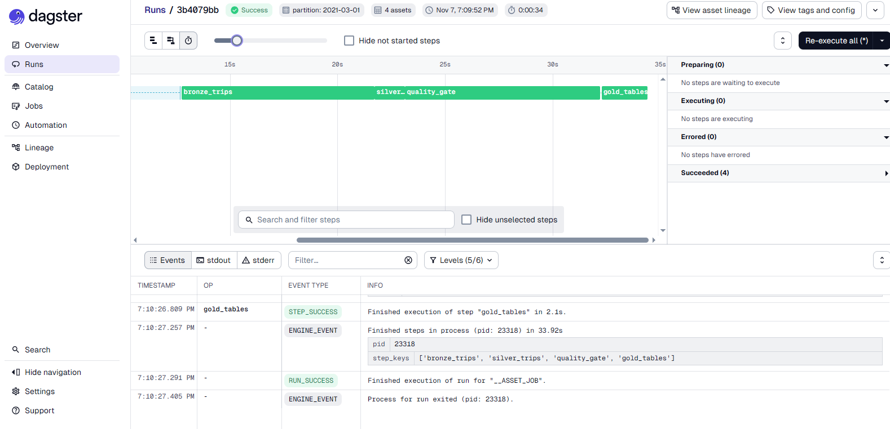
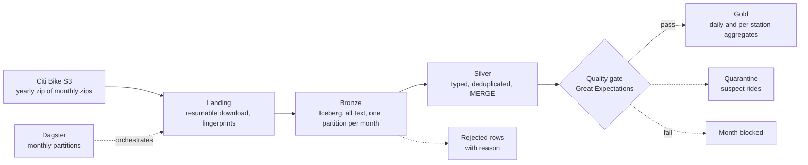

# Citi Bike Lakehouse

[](https://github.com/gashndolo/citibike-lakehouse/actions/workflows/ci.yml)

A batch lakehouse over a year of Citi Bike trips (27.1 million rides): raw monthly files land in Apache Iceberg tables (bronze), are typed and deduplicated with `MERGE` upserts (silver), pass a data-quality gate built on Great Expectations, and feed gold aggregates. Every step is idempotent, and the whole flow is orchestrated by Dagster with one partition per month.

**Stack:** Python · Apache Iceberg 1.10.1 · Apache Spark 4.0.1 · Great Expectations 1.x · Dagster · pytest · ruff · GitHub Actions




## Results at a glance

| | |
|---|---|
| Source | 2021 yearly zip (1.07 GB) of 12 monthly zips; 5.22 GB of CSV; **27,130,122 rides** |
| Bronze | 902.0 MB of Parquet in 54 files (**5.8x smaller** than the CSV); 11 months loaded in ~4.3 min (~100k rows/s) |
| Idempotency | Forced reload of March: 1,499,917 rows, **content hash identical** (before and after), one extra snapshot |
| Crash safety | `kill -9` during a reload: rows, content hash and snapshot count **unchanged** |
| Silver | 27,129,844 rows; 278 rejected, 0 duplicates; **every bronze row accounted for** in all 12 months |
| Quality gate | 12 of 12 months pass; 25,198 rides quarantined (0.093%); ~7 min for the year |
| Gate catches bad data | On deliberately corrupted data the gate fails on every injected problem (5 of 5); clean data passes |
| Schema and partition evolution | Adding and renaming a column rewrote **0 data files**; two partition layouts coexist in one table |


## Architecture



| Layer | What it holds | Key behavior |
|---|---|---|
| Landing | Yearly zip on disk, a manifest | Resumable download, skipped if unchanged; each month fingerprinted from the zip's own size and CRC32 directory |
| Bronze | Every column as text, plus `src_month`, `src_file`, `ingested_at`, `corrupt_record` | A month is replaced atomically (`overwritePartitions`); unchanged months are skipped |
| Silver | Typed trips, `row_hash` | `try_cast`, `TIMESTAMP_NTZ`, dedupe on `ride_id`, `MERGE` upsert |
| Rejected | Rows that cannot be trusted at all, with the reason | Nothing is silently dropped |
| Quality gate | Per-month pass or fail | Row-level quarantine plus 15 Great Expectations checks |


## Key design decisions

**A month is the unit of loading.** Each month is one Iceberg partition, replaced in a single atomic commit, so a rerun gives the same result and a crash leaves either the old data or the new data, never half of each.

**Change detection without extracting.** A zip stores each file's size and CRC32 in its directory. Hashing those gives a fingerprint per month, so the loader knows if a month changed without unpacking it. (CRC32 is for change detection here, not security.)

**Bronze is raw.** Everything is text, malformed lines are kept in a `corrupt_record` column, and new source columns are added with `ALTER TABLE ADD COLUMN` (metadata only). All cleaning happens in silver, so a typing bug is fixed by replaying bronze.

**Spark 4 runs in ANSI mode, so casts use `try_cast`.** A bad value becomes NULL instead of crashing the job, and an explicit rule then decides what to do with that row. Timestamps are `TIMESTAMP_NTZ` because the source has no UTC offset, and labeling them UTC would be wrong.

**Three different kinds of "bad".** Rows that cannot be used at all go to a *rejected* table (unparseable time, ended before started). Rows that are valid but suspect (over 24 hours, coordinates outside the city) go to *quarantine* and stay in silver. The *gate* decides whether a whole month is healthy, using thresholds calibrated from a profile of the data. Quarantine handles the odd ride; the gate catches a broken month.

**Upsert with a stored row hash.** Silver keeps a hash of each row's values, so "did this row change?" is one integer comparison, and a rerun inserts and updates nothing.

**Orchestration.** Dagster assets (bronze, silver, quality gate, and gold when present) share one monthly partition set. A failed quality gate fails the run, so nothing downstream is built for that month. Runs are queued one at a time because the local Iceberg catalog is not safe for concurrent writers.

## What the data turned out to contain

- **The files are cut by when a ride ends, not when it starts.** All 27,129,844 silver rows end within their own file's month; 7,630 (0.028%) started in an earlier month, some as far back as 2019. Partitioning by start month would scatter those rows into tiny partitions.
- **278 rides look like they end before they start.** All of them started between 01:11 and 01:59 on 2021-11-07, the hour that happens twice when US clocks go back. The source has no UTC offset, so their order cannot be recovered, and they are in the rejected table.
- **Trip durations:** median 663 s (11 min), p95 2,478 s, p99 5,146 s; the longest is 62,512,307 s (**723 days**). 25,198 trips (0.093%) last over 24 hours.
- **Station IDs are not numbers** (values like `6659.09`), so they are kept as strings. About 0.35% of rides have no end station.


## Verification

| Test | Result |
|---|---|
| Bronze idempotency (March, forced reload) | 1,499,917 rows and content hash identical before and after; `rows_replaced` = 1,499,917 |
| Bronze crash (`kill -9` during reload) | Rows, hash and snapshot count unchanged; the next run skipped the month |
| Silver reconciliation | bronze = silver + rejected + duplicates removed, 0 unexplained rows in all 12 months; `ride_id` is unique across the table |
| Quality gate on real data | 12 of 12 pass; closest threshold: trip duration, worst month 0.21% against 0.5% allowed |
| Gate on injected bad data (February, dry run) | Clean month passes; corrupted month fails on duplicate IDs (1.03%), over-24 h durations (3.04%), unknown category (2.02%), latitude outside area (1.98%), null start station (5.01%) |
| Schema evolution (add and rename column) | 0 data files rewritten; old rows read under the new name; the pre-change snapshot keeps the old schema |
| Partition evolution | Table with two partition specs returns the correct total (2,136,706 rows in the demo) |


All numbers are in `docs/metrics.md` with how each was measured.


## Incidents and lessons

- **I assumed monthly source files; the bucket has yearly zips, and each contains monthly zips.** The first loader stopped on the nested zips, which is what it was built to do. Nested-zip support was added and a zip-inspection script now reports the layout and every distinct column set before anything is loaded.
- **Silver is 28% larger than bronze** (1,158 MB against 902 MB), even though it is typed. The likely cause is the `row_hash` column: 27 million near-random 64-bit values do not compress. This was not isolated by measurement, and it is the price of cheap change detection.
- **A "bad data" rule turned out to be daylight saving time.** The 278 reversed rides all fall in the repeated hour, so the right response was to reject them and document why, not to repair them.

## Run it

Prerequisites: Python 3.12, Java 17, about 8 GB of free disk.

```bash
git clone https://github.com/gashndolo/citibike-lakehouse.git
cd citibike-lakehouse
cp .env.example .env
python3 -m venv .venv && source .venv/bin/activate
pip install -r requirements.txt -r requirements-dev.txt
```

**One layer at a time:**

```bash
python -m scripts.inspect_zip --year 2021        # download and show the layout and schemas
python -m lakehouse.bronze --year 2021
python -m lakehouse.silver
python -m lakehouse.quality
```

**With Dagster** (UI at http://localhost:3000; materialize a month, or launch a backfill over all 12 partitions):

```bash
scripts/dagster_dev.sh
```

Verification scripts: `python -m scripts.verify_bronze`, `verify_silver`, `show_quality`; the bad-data test: `python -m scripts.inject_bad_data`.

## Tests and CI

`pytest` runs the silver transforms, the quarantine rules and the orchestration logic. The transforms use a local Spark session with ANSI mode on; the orchestration tests replace the data layers with stubs and check that a failed gate stops the run. GitHub Actions runs lint, a compile check and the tests on every push.

CI does not run Iceberg or the Great Expectations checks against real tables. Those, and all the load, crash and reconciliation tests, were run locally.

## Known limitations

- Single machine and a local Hadoop-type Iceberg catalog; it is not safe for concurrent writers, which is why Dagster runs one job at a time. A production setup would use a REST or Glue catalog and object storage.
- One year (2021). The gate thresholds were calibrated on the same year, so they have not been tested on unseen data.
- Rides that run across a clock change (autumn or spring) carry a one-hour error in their duration that cannot be detected.
- The check that every ride ends inside its file's month runs in Spark next to the Great Expectations suite, so it shows in the results tables but not in Data Docs.

## Repository layout

```
lakehouse/     landing, bronze, silver, quality gate, gold, pipeline glue, Dagster definitions
scripts/       inspection, verification, bad-data injection, demos, maintenance
tests/         unit tests
dagster_home/  Dagster instance config (one run at a time)
gx/            Great Expectations config and saved suite
docs/          screenshots and metrics log
```

## Acknowledgements

Trip data published by NYC Bike Share
[Citi Bike system data](https://citibikenyc.com/system-data) 